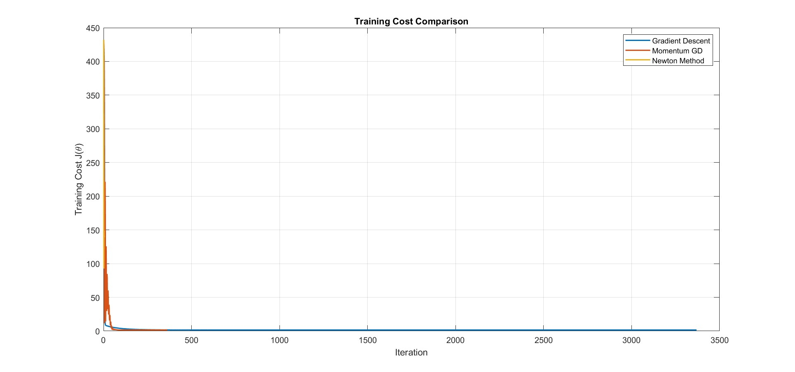
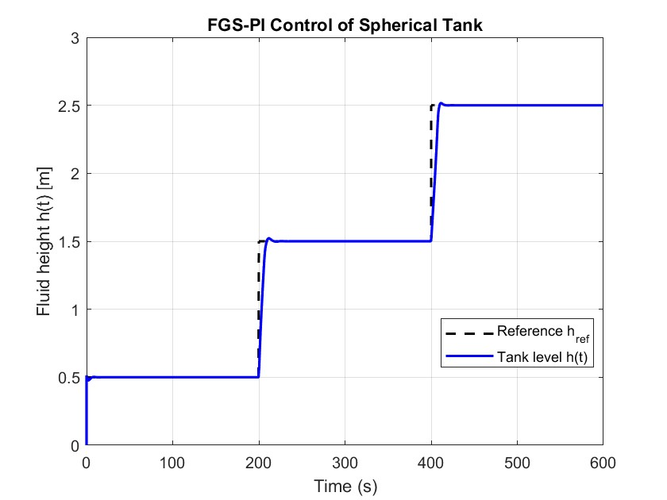
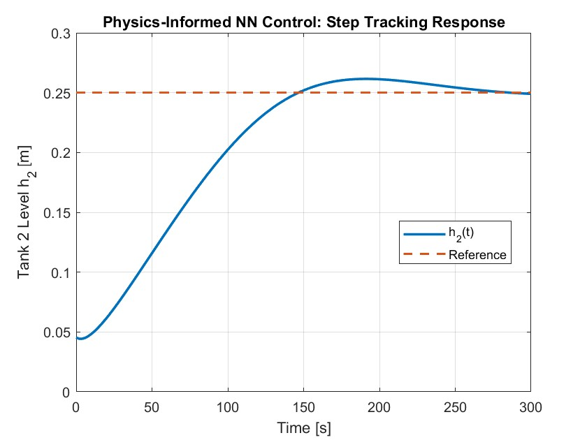

# KON 426E — Intelligent Control Systems

İstanbul Teknik Üniversitesi, **2025–2026 Bahar** dönemi Intelligent Control Systems dersi için hazırlanan MATLAB ödevleri ve çift tank kontrolü dönem projesi.

**Hazırlayan:** Atakan Kuşçu

## İçerik

| Bölüm | Konular | Kod ve çalıştırma | Rapor |
| --- | --- | --- | --- |
| Ödev 1 | Doğrusal olmayan regresyon, GD / momentum / Newton karşılaştırması, MPC, adaptif PID | [Assignment 01](assignments/assignment-01/README.md) | [PDF](assignments/assignment-01/reports/Intelligent_Control_Systems_HW1.pdf) |
| Ödev 2 | NARX sistem tanılama, bulanık kazanç ayarlamalı PI, USV navigasyonu | [Assignment 02](assignments/assignment-02/README.md) | [PDF](assignments/assignment-02/reports/Intelligent_Control_Systems_HW2.pdf) |
| Dönem projesi | Çift tank sistemi, PI, fizik tabanlı ters modelle eğitilen sinir ağı, NN ile yaklaşık NMPC | [Double tank](project/double-tank/README.md) | Proje raporu yerel kaynaklarda bulunmuyor |

## Klasör düzeni

```text
assignments/
  assignment-01/       # src/, data/, figures/, reports/
  assignment-02/       # src/, controllers/, dependencies/, figures/, reports/
project/
  double-tank/         # src/, data/, figures/
docs/                  # Taşıma kaydı, doğrulama ve sonraki işler
setup_course.m         # Bölüm seçimi ve MATLAB yol ayarları
CONTRIBUTING.md         # Yeni çalışma ve commit düzeni
```

## Başlangıç

MATLAB'ı repo kökünde açıp çalışmak istediğin bölümü seç:

```matlab
setup_course('hw1');
hw1_part1;
```

Diğer seçenekler `setup_course('hw2')` ve `setup_course('project')`. Yardımcı fonksiyon ilgili bölümün çalışma klasörüne geçer ve kaynak/veri klasörlerini MATLAB yoluna ekler. Sonraki bölüm seçiminde yeniden çağrılabilir.

MATLAB **R2025b** yerel doğrulama ortamıdır. Kullanılan özelliğe göre Optimization Toolbox, Deep Learning Toolbox ve Fuzzy Logic Toolbox gerekir. Ayrıntılar bölüm README dosyalarındadır; tüm deneyler yalnızca temel MATLAB ile çalışmaz.

## Örnek sonuçlar

### Ödev 1 — optimizasyon yöntemleri



### Ödev 2 — bulanık PI kontrolü



### Dönem projesi — seviye takibi



## Çalışma düzeni ve mevcut durum

Kaynak kodlar, raporlar ve mevcut sonuçlar bölüm bazında tutulur. Yeni deneylerde referans, başlangıç koşulu, örnekleme süresi ve ağ/model sürümü kaydedilir. Üretilen geçici çıktılar otomatik olarak Git dışında kalır; paylaşılacak sonuçlar `figures/` veya `data/` altına bilinçli olarak alınır.

- [Çalışma ve commit düzeni](CONTRIBUTING.md)
- [Sonraki işler](docs/ROADMAP.md)
- [Doğrulama ve çalıştırma sınırları](docs/VALIDATION.md)
- [Taşıma kapsamı ve dosya eşlemesi](docs/MIGRATION.md)

Ödev 2'nin NARX deneyi ders kapsamında sağlanan `System1.p` dosyasını gerektirir. Bu harici bağımlılık Git ile yayımlanmaz. Bazı proje testleri eğitimden kalan `net` değişkenini gerektirir; her `.mat` dosyası birbiriyle uyumlu ağ içermez. Çalıştırmadan önce ilgili bölümdeki sırayı izleyin.
